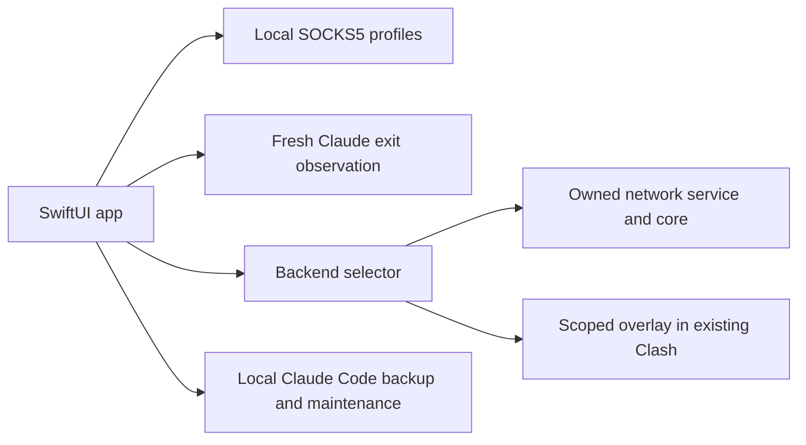

# Architecture

ccmiss is a native macOS network workspace for Claude-related services. The SwiftUI application manages local profiles, shows the actual active account, and observes Claude's exit IP independently of the selected sidebar row.

## Network ownership

`Resources/network-engine.js` selects a single backend. An existing transaction or active standalone session takes priority over discovering another proxy application. Uncertain ownership stops the operation instead of silently migrating the network.

In standalone mode, a signed helper owns the proxy core, TUN interface, and DNS restoration journal. In coexistence mode, ccmiss adds only the managed service rules and corresponding DNS policy to a supported, already-running Clash Verge Rev configuration. Other subscription rules and active connections are retained where the underlying core supports them.

Default service targets cover Claude/Anthropic, Cloudflare's own services, Stripe/Link, and the supported diagnostic endpoints. The fixed Anthropic API ranges follow the [official API network documentation](https://platform.claude.com/docs/en/api/ip-addresses). The public source contains no personal API relays, organization DNS defaults, account profiles, or proxy subscriptions.

## Observation and activation

Selecting a profile changes only the detail view. Activating it performs readiness and connectivity checks before applying the network configuration. An active profile offers a stop-and-restore action. Switching profiles affects new connections; it does not force old TCP streams to reconnect.

`ClaudeExitProbe` creates a fresh ephemeral HTTPS session through the current macOS network path. It validates the response origin, HTTP status, IP format, response size, and timeout. Request identifiers and network-operation revisions reject late results after a switch. A missing result is shown as unknown, never replaced with the configured proxy address.

Status colors describe exit consistency: green for an observed system exit or a matching account exit, red for a mismatch, and gray while unknown. They do not classify IP reputation.

## Browser configuration

Browser leak protection is an application-level setup step. Supported Chromium-family browser settings can restrict non-proxied WebRTC UDP. Configuration writes require the relevant macOS file access and a closed browser, and preserve a local backup. Unsupported browsers require manual configuration. The software does not grant its own privacy permissions or close the user's browser.

## Claude Code tools

The tools read local conversation records and create browseable local archives with Markdown views. Backups can cover all conversations or a date range and can be deleted after confirmation. Import preparation creates context for a new session; it does not restore old session identities or login state.

Installation maintenance is user-initiated and checks for running clients before proceeding. It creates and verifies a full backup before supported reinstall operations. Unknown or customized installations remain untouched. See [security and privacy](../SECURITY.md) before sharing any archive.

## Source distribution

The repository contains source, fixtures, build tooling, documentation, and brand artwork. Node.js and Mihomo are fetched from pinned upstream releases into an ignored dependency directory and checked before use. Generated bundles, signing material, dependency archives, local reports, and user data are not part of Git history.

The native interface currently uses Chinese labels. English and Chinese project documentation are provided separately.
